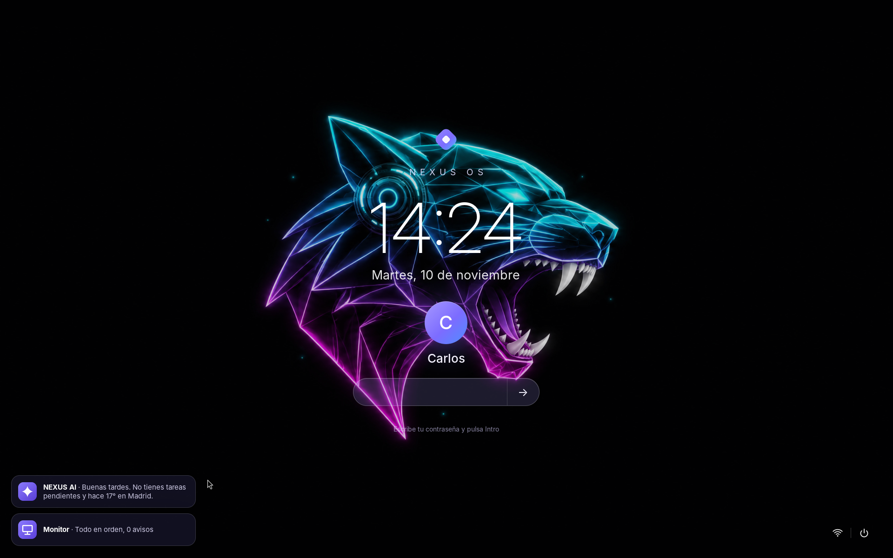
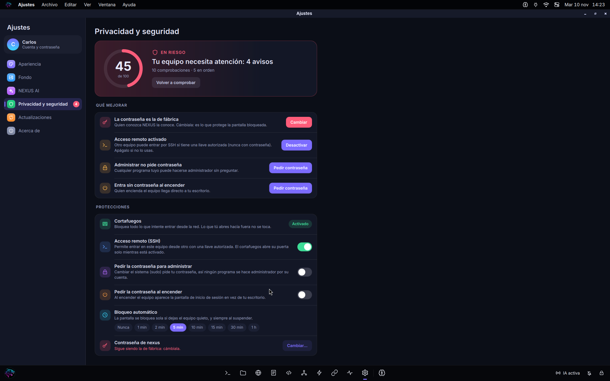
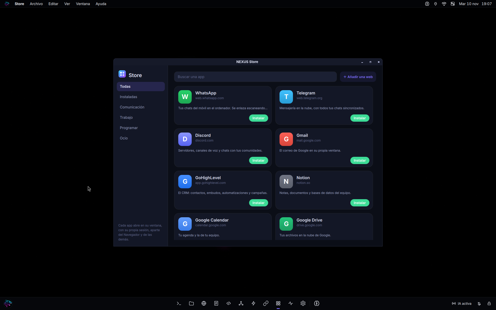

# NEXUS OS

A Linux operating system built around one idea: **AI agents should be able to work on your computer without
being able to hurt it.**

NEXUS OS is a real, bootable distribution (Debian 13 base, its own desktop written in Qt/QML) where every AI agent
runs isolated in one project folder, anything critical waits for your click, and the system itself is locked down
by default. The part that makes agents safe also works on its own, on any Linux or Mac:
[`nexus-agent`](cli/README.md).



> **Status: developer preview.** It boots and is used daily in virtual machines (Apple Silicon Macs, and x86-64 in
> VirtualBox). It has not been installed on real hardware yet and has had no independent security review.
> The interface is in Spanish; the standalone tool and its documentation are in English.

## Start here: `nexus-agent`

You do not need the whole operating system to use its best part.

```sh
cd ~/projects/web
nexus-agent -- claude        # Claude Code, isolated in this folder
nexus-agent doctor           # watch the sandbox block real escape attempts on your machine
```

The agent gets the project, a private home and your tools. It does not get your SSH keys, tokens, the rest of your
home, other disks, the clipboard or other apps. `git push`, `rm -r`, `DROP TABLE` or a deploy open a dialog whose
default button is "Deny". Your API key never enters the sandbox. See [cli/README.md](cli/README.md) for how it
works and for its limits.

## What is in the operating system

| | |
|---|---|
| **Agents** | Named agents with capabilities (MCP URIs), a sandbox each (bubblewrap), risk rules for every command, human approval for critical ones, a review committee for commits, token and dollar budgets, a watchdog for loops. |
| **NEXUS AI** | An assistant panel (Super+Space) that opens apps, answers about the system, organises files and drafts automations and agents from a sentence. It proposes; you confirm. |
| **Guard** | Firewall on before the network comes up, automatic screen lock, kernel hardening, a small root daemon with six fixed operations, and a settings page that scores the computer and fixes what it finds with one click. Making the computer safer never asks for a password; making it less safe always does. |
| **Update** | Signed updates (ed25519), small delta bundles, a health check after installing and automatic rollback when the desktop does not come back. |
| **Apps** | Files, Notes, Browser (QtWebEngine) with NEXUS Search, Mail (IMAP/SMTP with app passwords), Store (web apps in their own windows and sessions), Automations, Connections (GoHighLevel, Wiwink, any JSON API), Monitor, Settings. |
| **Desktop** | Its own shell: menu bar, dock, Control Center, lock screen and login screen, wallpapers that follow the hour. Wayland (labwc). |





## Repository layout

```
core/src/     the engine and the session daemon (TypeScript, no build step: Node runs it directly)
core/test/    the tests (node --test): 353 of them, including sandbox escape attempts enforced for real on macOS
cli/          nexus-agent, the standalone tool, and its README
os/           the image: mkosi configuration, the files that go into it (os/mkosi.extra), build script, update tools
os/mkosi.extra/usr/share/nexus/   the desktop shell and the apps (QML)
vm/           running it: the Virtualization.framework runner for Macs, the Windows/VirtualBox launcher, lab scripts
docs/         architecture notes, concept art, screenshots
```

## Build and test

```sh
npm install
npm test                                   # the whole suite

# the standalone tool, as one file
npx esbuild cli/nexus-agent.ts --bundle --platform=node --format=esm --target=node20 --outfile=cli/dist/nexus-agent.mjs
node cli/dist/nexus-agent.mjs doctor

# the operating system image (inside a Debian 13 builder VM; see vm/README.md)
os/build.sh                                # arm64
NEXUS_ARCH=amd64 os/build.sh               # x86-64
```

Node 24 for development (the engine runs TypeScript directly); Node 20 or newer for the bundled `nexus-agent`.

## Security model, in short

- **Deny by default.** An agent sees nothing it was not given. The sandbox does not depend on the risk rules: a
  command no rule knows still runs isolated, without keys.
- **A human decides what matters.** Critical commands wait for a click. Keys are reachable only by a command the
  person approved, and only for that command.
- **Privileged code is small and fixed.** The root daemons (updates, guard) accept a short list of operations with
  checked arguments, on a unix socket, never a command line from the caller.
- **Secrets stay where they belong.** API keys live with the service that uses them and are never sent back to the
  desktop, written to logs or put on a command line.

Known limits are written down, not hidden: see [cli/README.md](cli/README.md#limits-you-should-know). If you find a
way through, please open an issue.
